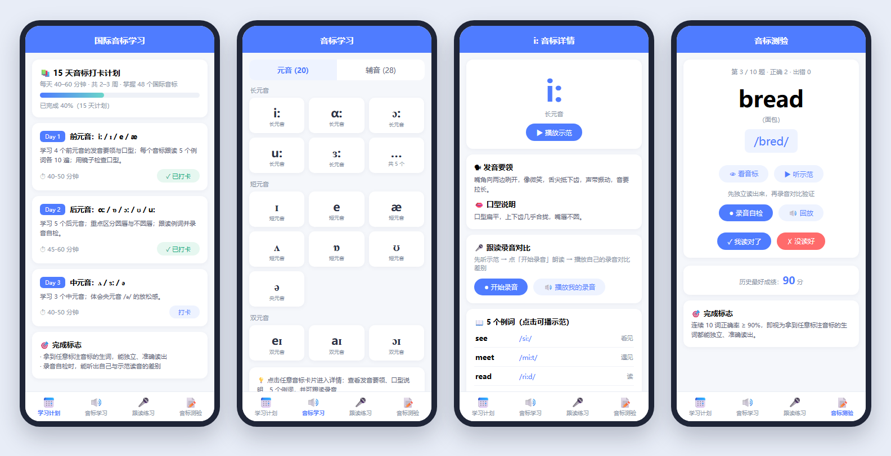

# 国际音标学习小程序（phonetics-miniprogram）

一个零后端、开箱即用的微信小程序：帮助英语零基础学习者在 15 天内掌握 **48 个国际音标**（会读、会写），理解重音 / 连读 / 吞音的基本概念，并通过录音自检与生词测验，最终达成——**拿到任意标注音标的生词，能独立、准确读出**。

<p align="center"></p>

## 一、项目解决什么问题

零基础学英语的第一道坎是音标：见词不会读、读音没人纠。本项目把音标学习拆解为一条可执行的路径，解决三个痛点：

1. **学什么、按什么顺序学**：内置 15 天打卡日程（每天 40–60 分钟），元音 → 辅音 → 总复习 → 综合测验，不用自己规划。
2. **每个音怎么发**：48 个音标全部配发音要领、口型说明和 5 个例词，并有可播放的示范发音。
3. **读得对不对**：录音回放与示范对比（自检），随机生词测验判分（他检），正确率 ≥ 90% 即视为达成学习目标。

学习进度（打卡、测验成绩、跟读次数）保存在手机本地，无需注册登录、无需服务器。

## 二、主要功能

| 模块   | 入口（Tab） | 功能                                                                                                                   |
| ---- | ------- | -------------------------------------------------------------------------------------------------------------------- |
| 学习计划 | 学习计划    | 15 天打卡日程与进度条；每日任务说明；完成标志；推荐资源；重音/连读/吞音概念讲解                                                                           |
| 音标学习 | 音标学习    | 元音（长 5 / 短 7 / 双元音 8）与辅音（爆破 6 / 摩擦 10 / 破擦 6 / 鼻音 3 / 边音 1 / 半元音 2）分类展示 48 个音标；详情页含发音要领、口型说明、5 个标注音标例词（每个可点读）、前后音标切换 |
| 跟读练习 | 跟读练习    | 随机出音标：播放示范发音 → 自己朗读并录音 → 回放对比；「读准了，下一个」累计过关次数；附「三步听差法」自检指引                                                           |
| 音标测验 | 音标测验    | 随机抽 10 个标注音标的生词；先独立朗读，可看音标、听示范、录音自检，再自判对错；结束给出得分、历史最好成绩；正确率 ≥ 90% 提示达成完成标志                                           |

所有音频已内置：48 个音标**纯发音**（espeak-ng 按音素合成）+ 212 个例词/测验词示范（微软 Edge 神经语音）。

## 三、安装方法

1. 安装微信开发者工具：<https://developers.weixin.qq.com/miniprogram/dev/devtools/download.html>
2. 打开开发者工具 →「导入项目」→ 选择 `phonetics-miniprogram` 目录
3. AppID 两选一：
   - 直接用游客模式（项目已配置 `touristappid`），可在模拟器中完整体验；
   - 点击输入框右侧「测试号」扫码申请测试 AppID，或注册正式小程序获取 AppID（`wx` 开头），支持真机预览与上传发布。
4. 真机预览时首次使用录音功能，会弹窗请求麦克风权限，需允许。

> 可选：重新生成音频。音标纯发音：`pip install espeakng-loader` 后运行 `python tools/gen_phoneme_audio.py`；例词示范：`pip install edge-tts imageio-ffmpeg` 后运行 `python tools/gen_audio.py`。

## 四、使用方法

按首页的 15 天日程推进，每天约 40–60 分钟，典型一天的操作流程：

1. **打卡**：打开「学习计划」Tab，找到当天（如 Day 1），点击「打卡」按钮，进度条前进。
2. **学新音标**：点击日程卡片跳到当天第一个音标的详情页，阅读发音要领与口型说明；点击「播放示范」听该音标发音；逐个点击 5 个例词听读；用「← 上一个 / 下一个 →」遍历当天所有音标。
3. **跟读自检**：进入「跟读练习」Tab，点击「▶ 听示范」→「● 录音」朗读 →「🔊 我的录音」回放，对比差别；确认读准后点「✓ 读准了，下一个」随机练下一个。
4. **阶段测验**：进入「音标测验」Tab，点「开始测验」；每题先自己独立读出该生词，再看音标、听示范、录音验证，然后自判「✓ 读对了 / ✗ 没读好」；10 题后查看得分。
5. **达成目标**：Day 15 综合测验正确率 ≥ 90% 时，页面提示达成完成标志。

进度重置：删除小程序或清除微信缓存即可清空打卡记录。

## 五、输入输出示例

**例 1：音标学习（音标学习 Tab → 点击卡片 `iː`）**

输入：点击列表中的音标卡片  
输出：详情页展示

```
/iː/（长元音）
发音要领：嘴角向两边咧开，像微笑，舌尖抵下齿，声带振动，音要拉长。
口型说明：口型扁平，上下齿几乎合拢，嘴唇不圆。
例词：see /siː/ 看见   meet /miːt/ 遇见   read /riːd/ 读
      green /ɡriːn/ 绿色   team /tiːm/ 队伍
```

点击任意例词播放 `audio/words/see.mp3`；点击「播放示范」播放 `audio/ii.mp3`（/iː/ 纯元音）。

**例 2：跟读录音对比（跟读练习 Tab）**

输入：随机抽中 <u>p</u> → 依次点击「▶ 听示范」「● 录音」（朗读后）「■ 停止」「🔊 我的录音」  
输出：先播放 `audio/p.mp3`（"puh"）；录音生成临时文件并回放；点击「✓ 读准了，下一个」后过关计数 +1

```
累计跟读过关：12 次   ← 保存于本地存储 practiceCount
```

**例 3：音标测验（音标测验 Tab）**

输入：点击「开始测验」→ 第 3 题出词 `bread（面包）` → 独立朗读 → 点「👁 看音标」→ 对照自判「✓ 我读对了」  
输出：显示音标 `/bred/`，播放 `audio/words/bread.mp3`；10 题完成后输出成绩单

```
测验完成！ 9 / 10   正确率 90%
历史最好成绩：90 分
🎉 正确率 ≥ 90%，达成完成标志：拿到任意标注音标的生词都能独立、准确读出！
```

**例 4：每日打卡（学习计划 Tab）**

输入：Day 1 卡片点击「打卡」  
输出：按钮变为「✓ 已打卡」，进度条按已打卡天数 / 15 前进

```js
// 本地存储 checkins 的实际数据结构
{ "1": "2026/10/17", "2": "2026/10/18" }
```

## 六、示范音频说明（已内置，无需配置）

```
audio/
  ii.mp3  i.mp3  e.mp3  ae.mp3 ... ng.mp3   # 48 个音标纯发音（espeak-ng 按音素合成）
  words/
    see.mp3  meet.mp3  bread.mp3 ...       # 全部例词 + 测验词示范（共 212 个）
```

- 音标纯发音：元音为纯元音；辅音采用「音素+央元音」示范法（/p/ → "puh"）；/ɒ/ 用英式声库合成（美音已与 <u>ɑː</u> 合并）
- 音标符号含特殊字符，音频文件名使用 ASCII 映射（如 `iː → ii.mp3`、`tʃ → ch.mp3`），映射表见 `utils/data.js` 的 `AUDIO_IDS`

> 想换成真人发音（英语兔/赖世雄音频截取），用同名文件覆盖对应 mp3 即可，代码无需改动

## 七、推荐资源（已内置在首页）

1. B 站「英语兔」音标全集 —— 口型演示直观，适合入门跟学
2. 赖世雄《美语音标》配套音频 —— 讲解细致，适合精听模仿
3. 每日英语听力 App —— 海量真人口语材料，用于跟读与听力自检

## 八、15 天学习路线

| 天         | 内容                                              |
| --------- | ----------------------------------------------- |
| Day 1–3   | 元音：前元音 iː ɪ e æ → 后元音 ɑː ɒ ɔː ʊ uː → 中元音 ʌ ɜː ə |
| Day 4–5   | 双元音 eɪ aɪ ɔɪ əʊ aʊ ɪə eə ʊə + 20 元音总复习          |
| Day 6–7   | 爆破音 p b t d k g + 元音阶段测验                        |
| Day 8–10  | 摩擦音 f v θ ð s z ʃ ʒ h r + 阶段测验                  |
| Day 11–12 | 破擦音 tʃ dʒ tr dr ts dz + 鼻音 m n ŋ                |
| Day 13    | 边音 l、半元音 w j                                    |
| Day 14    | 48 音标总复习 + 重音/连读/吞音概念                           |
| Day 15    | 综合测验：随机生词朗读测试（测验模块每轮 10 词），正确率 ≥ 90% 达成完成标志 |

## 九、项目结构

```
phonetics-miniprogram/
├── app.js / app.json / app.wxss     # 全局配置与样式（tabBar 四个 Tab）
├── project.config.json / sitemap.json
├── LICENSE                          # MIT 开源许可（署名 HugoWu03）
├── .gitignore                       # 忽略本机配置 project.private.config.json 等工具生成文件
├── audio/                           # 已内置音频：音标纯发音 48 个 + 例词/测验词 212 个
├── tools/
│   ├── gen_phoneme_audio.py         # 音标纯发音生成（espeak-ng，按音素合成）
│   ├── gen_audio.py                 # 例词/测验词示范生成（微软 Edge 神经语音）
│   └── audio_manifest.json          # 音频清单（由 data.js 导出）
├── utils/
│   ├── data.js                      # 48 音标数据、例词、测验词库、15 天计划、AUDIO_IDS 映射
│   └── audio.js                     # 播放示范 / 例词点读 / 录音回放封装
└── pages/
    ├── index/    学习计划（15 天打卡 + 资源 + 概念讲解）
    ├── learn/    音标分类列表（元音 20 / 辅音 28）
    ├── detail/   音标详情（要领 + 口型 + 例词点读 + 跟读录音）
    ├── practice/ 跟读练习（随机音标 + 过关计数）
    └── quiz/     音标测验（随机 10 词 + 成绩与完成标志判定）
```

## 十、开源许可

代码以 [MIT License](LICENSE) 授权（© 2026 HugoWu03）。`audio/` 内的示范音频由 espeak-ng 与微软 Edge 神经语音生成，替换真人发音时请自行确认素材授权。
